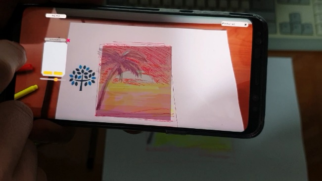

# Art Animation

종이에 그림을 따라 그릴 수 있도록 단계별 밑그림을 카메라 화면 속 종이 위에 겹쳐 보여 주고, 다 그린 그림을 찍어 바람에 흔들리는 애니메이션으로 바꿔 주는 안드로이드 AR 앱이다. Vuforia 로 종이에 인쇄한 이미지 타깃을 인식하고, 찍은 그림은 Anima2D 로 뼈대를 심은 스프라이트 메시에 입혀 움직인다. 학교 팀 과제로 만들었다.




## 사용 방법

Unity 2018.1.9f2 에서 `source/` 를 열고 `Assets/01. Scenes/SampleScene.unity` 를 안드로이드로 빌드한다. 열기 전에 다음을 준비한다.

1. Unity 를 설치할 때 Android Build Support 와 Vuforia Augmented Reality Support 구성요소를 같이 고른다. 프로젝트를 연 뒤 메뉴 GameObject > Vuforia > AR Camera 를 한 번 추가하면 Unity 가 Vuforia 에셋을 `Assets/Vuforia/` 로 가져온다. 이때 새로 생긴 AR Camera 는 지운다. 원본은 Vuforia 7.2.24 를 썼다.
2. `Assets/Resources/VuforiaConfiguration.asset` 의 App License Key 에 developer.vuforia.com 에서 발급받은 자신의 키를 넣는다.
3. 아래 에셋을 받아 표의 경로에 넣는다. Anima2D 는 그림의 스프라이트 메시와 뼈대, IK 가 모두 Anima2D 컴포넌트라서 가져와야 씬의 애니메이션이 동작한다. Unity Asset Store 에서 무료로 배포되던 패키지로, 지금은 판매가 끝나 예전에 받은 계정의 My Assets 에서 받을 수 있다. 녹화 플러그인은 `MenuCtrl` 과 `UIController` 가 `AndroidUtils` 클래스를 부르므로 넣어야 스크립트가 컴파일된다. 다른 사람이 만든 에셋 중 공개 레포에 재배포할 수 있는지 정해지지 않은 것은 넣지 않았다.

| 에셋 | 제작자 | 넣을 경로 | 원본에서 쓰인 곳 |
|---|---|---|---|
| Anima2D (원본 v1.1.5) | Mandarina Games, Unity Technologies 배포 | `Assets/Anima2D/`, `Assets/Editor Default Resources/Anima2D/`, `Assets/Gizmos/` | `ArtBone`, `ArtBone2` 의 스프라이트 메시, 뼈대, IK |
| Android 화면 녹화 플러그인 `unityrecorder-release.aar`, `AndroidUtils.cs`, `AndroidManifest.xml` | 추가 확인 대상 (패키지 `com.setik.kampertee`) | `Assets/Plugins/Android/`, `Assets/02. Scripts/AndroidUtils.cs` | 화면 녹화, 갤러리 열기, 권한 요청 |
| Camera Filter Pack (원본 v4.0.0) | VETASOFT | `Assets/Camera Filter Pack/` | 프로젝트에 함께 들어 있던 카메라 필터 스크립트 |
| Low Poly UI Kit (원본 v1.1c) | 추가 확인 대상 | `Assets/04. Images/Low Poly UI Kit - v.1.1c/` | `SampleScene` 과 `CreateLight` 씬의 메뉴 버튼과 패널 그림 |
| Butterfly Eastern Tailed Blue | Unluck Software | `Assets/07. Models/` | 나비 모델 |
| Vuforia 에뮬레이터 타깃과 인쇄용 타깃 PDF | PTC (Vuforia) | `Assets/Editor/Vuforia/Emulator/`, `Assets/Editor/Vuforia/ForPrint/` | 에디터 재생용 에뮬레이터 타깃 `VuforiaEmulator` 와 인쇄용 `Emulator Ground Plane.pdf` |

앱에서는 이미지 타깃(`Assets/Editor/Vuforia/ImageTargetTextures/ARdraw/MJC_scaled.jpg`)을 인쇄한 종이를 비춘다. 타깃 오른쪽에 밑그림이 떠서 그 자리에 따라 그리면 된다.

| 조작 | 동작 |
|---|---|
| 오른쪽 위 드롭다운 | 따라 그릴 그림 고르기. `Picture0` 은 야자수가 있는 노을(7단계), `Picture1` 은 별이 빛나는 밤(13단계) |
| Information 패널의 이전·다음 | 밑그림 단계 넘기기 |
| 슬라이더 | 밑그림 투명도 |
| MENU > Light | Create Light 를 누른 뒤 그림을 터치하면 점광원을 놓는다. 다시 누르면 선택 모드로 돌아가 점광원을 끌어 옮기고 Delete Light 로 지운다 |
| MENU > Capture | 화면 가운데 567x627 사각형이 뜬다. Capture 로 그 안을 찍고 Animation 으로 찍은 그림을 움직인다 |
| MENU > Record | 화면을 최대 10초 녹화해 `DCIM/ARSketch` 에 저장한다 |
| MENU > Share | 갤러리를 연다 |
| MENU > Quit | 종료 |


## 구현 원리

**찍은 그림을 미리 만든 뼈대 메시에 색만 옮긴다.** 그림마다 움직일 부분(야자수, 사이프러스)의 모양대로 잘라 둔 567x627 텍스처 `ArtBone` 과 배경용 `ArtTerrain` 이 있고, `ArtBone` 은 Anima2D 로 뼈대와 IK 를 심은 스프라이트 메시다. Animation 버튼을 누르면 `TextureLoader.Copy` 가 찍은 그림의 RGB 만 두 텍스처에 덮어써서 알파는 그대로 남는다. 그래서 움직일 부분의 모양은 유지된 채 사용자가 칠한 색이 입혀진다.

```csharp
destColors[destIndex].r = sourceColors[sourceIndex].r;
destColors[destIndex].g = sourceColors[sourceIndex].g;
destColors[destIndex].b = sourceColors[sourceIndex].b;
```

**배경에서는 움직일 부분을 지운다.** 그대로 두면 나무가 흔들릴 때 배경에 같은 그림이 남아 겹쳐 보인다. `TextureLoader.ClearOverlap` 은 `ArtBone` 의 알파가 0 이 아닌 픽셀을 그 줄의 맨 오른쪽 픽셀 색으로 칠해 빈자리를 주변 색으로 메운다.

```csharp
Color32 ClearColor = targetColors[GetIndex(target, width - 1, j)];
...
if (maskColors[maskIndex].a != 0)
    targetColors[targetIndex] = ClearColor;
```

**흔들림은 사인 곡선의 변화량으로 만든다.** `WindCtrl` 은 야자수 잎 뼈대 8개를 돌리고, `WindCtrl2` 는 사이프러스의 IK 목표 5개를 옮기면서 돌린다. 매 프레임 더하는 양은 `Mathf.Sin(time + Time.deltaTime) - Mathf.Sin(time)` 에 속도를 곱한 값이다. 사인 값 자체가 아닌 변화량을 더하므로 처음 놓인 자세를 중심으로 흔들린다.

녹화와 갤러리 열기는 `MenuCtrl` 이 위 표의 안드로이드 화면 녹화 플러그인을 불러 처리한다.


## 파일

| 경로 | 내용 |
|---|---|
| `source/Assets/01. Scenes/SampleScene.unity` | 앱 씬 |
| `source/Assets/02. Scripts/` | 메뉴, 드롭다운, 점광원, 캡처 스크립트 |
| `source/Assets/ArtAnimation/`, `source/Assets/ArtAnimation2/` | 그림별 스프라이트 메시 데이터, 텍스처, 흔들림 스크립트 |
| `source/Assets/UnityUIExtensions/` | Unity UI Extensions 와 그 라이선스 `LICENSE.md` |
| `source/Assets/04. Images/` | 단계별 밑그림 |
| `source/Assets/StreamingAssets/Vuforia/` | 이미지 타깃 데이터베이스 `ARdraw` |
| `source/Assets/05. Assets/JW/`, `source/Assets/99. Test/` | 점광원 실험 씬과 테스트 씬 |
| `source/ProjectSettings/` | Unity 2018.1.9f2 프로젝트 설정 |
| `docs/screenshots/` | 스크린샷 |


## 크레딧

- Unity UI Extensions: Unity UI Extensions 커뮤니티의 BSD-3-Clause 라이선스 UI 확장. 캡처 사각형을 그리는 `UILineRenderer` 를 썼다. `Assets/UnityUIExtensions/`


## 라이선스

zlib 라이선스다. 자세한 내용은 [LICENSE](LICENSE) 에 있다. 함께 들어 있는 것 중 다른 사람이 만든 라이브러리는 각자의 라이선스를 따른다.
